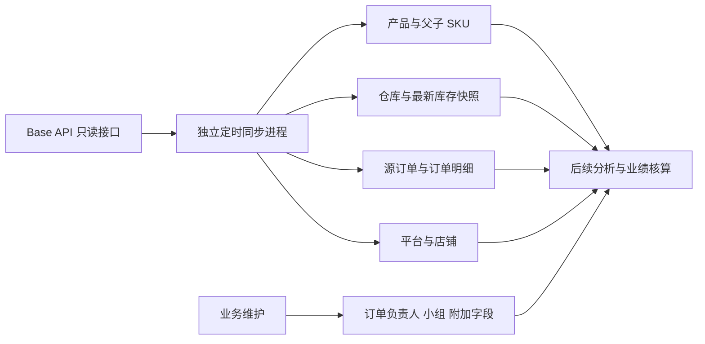

# Base 数据接入设计

## 数据流

源接口字段保持原意，人工归属使用独立表；报表层后续按经过确认的时间、状态、商品映射及业务归属规则计算。数据接入不直接认定所有导入订单都应计入销量。

## 关联键

- 目录和产品：`inventory_id + product_id`。同一目录中的 `parent_id` 指向父产品 ID，查询时关联父产品的 SKU。没有父关系的产品同时显示自身 SKU；缺失父记录时父 SKU 为 null，不猜测型号。
- 平台和店铺：`platform + shop_id`。店铺 ID 不可跨平台单独作为唯一键。
- 库存：`inventory_id + product_id + warehouse_key`。仓库键保持 Base 的类型及 ID 组合，保留原仓库元数据。
- 订单：Base `order_id` 为单账号内部唯一键，另外保留平台订单号；订单明细保存 `storage`、`storage_id`、`product_id`、`variant_id`、SKU 及原字段。
- 订单人工归属：`order_id` 外键指向源订单；本地自定义字段与 Base 自定义字段分别返回和保存。

当前只支持一个 Base 账号。若增加多个账号，需在所有来源键及同步任务中加入账号维度，不能直接复用本结构写入另一账号。

## 自动同步与失败处理

worker 按店铺、产品、库存、订单顺序执行一轮；一个域失败仍继续其他域。完成后等待配置间隔。每域使用数据库 running 唯一约束互斥，所有真实 API 调用共用数据库节流预算。

产品详情从包含变体的产品列表逐批读取；库存来自同一详情接口的 stock、reservations 和 incoming。未知数量保存为 null；仓库字段保持来源类型。产品和库存完整抓取后在一个事务中发布，异常不会把不完整列表认定为来源删除。

订单采用 `id_from` 分页，请求包含未确认订单；页面必须按 ID 递增且前进，否则任务失败。每页源订单和明细在同一事务中提交，原始 JSON 保留未来新增字段。重跑全量扫描更新旧数据，不修改人工归属。库存快照和订单全量扫描不是跨域同一时刻事务，页面分别展示更新时间。

当前库存仅保存最新抓取快照，库存更新时间是中台抓取时间。大数据量下全量扫描耗时需实测；后续可使用订单日志获取变化 ID 并定期全量核对，不应直接改成只获取新订单而漏掉旧订单更新。

## 官方接口

- [订单读取 getOrders](https://api.baselinker.com/index.php?method=getOrders)：ID 分页、未确认订单、可选附加字段及日期字段。
- [目录列表 getInventories](https://api.baselinker.com/index.php?method=getInventories)：目录 ID 及仓库关系。
- [包含变体的产品列表 getInventoryProductsList](https://api.baselinker.com/index.php?method=getInventoryProductsList)：分页产品及父关系。
- [产品详情 getInventoryProductsData](https://api.baselinker.com/index.php?method=getInventoryProductsData)：父关系、SKU、库存、预占和供应商待入库。
- [仓库列表 getInventoryWarehouses](https://api.baselinker.com/index.php?method=getInventoryWarehouses)：仓库类型、外部及内部标识。
- [订单来源 getOrderSources](https://api.baselinker.com/index.php?method=getOrderSources)：平台店铺名称映射。

正式报表前待确认：Base 父 SKU 与业务型号的对应关系、平台原始订单时间字段、取消及退货销量规则、跨编码归并、库存性质和所属小组，以及订单负责人和销售小组的维护与变更规则。
